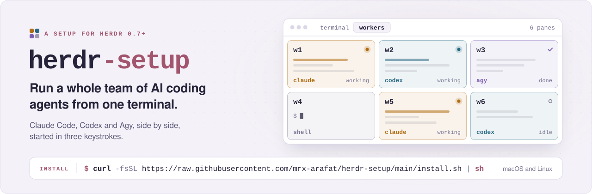
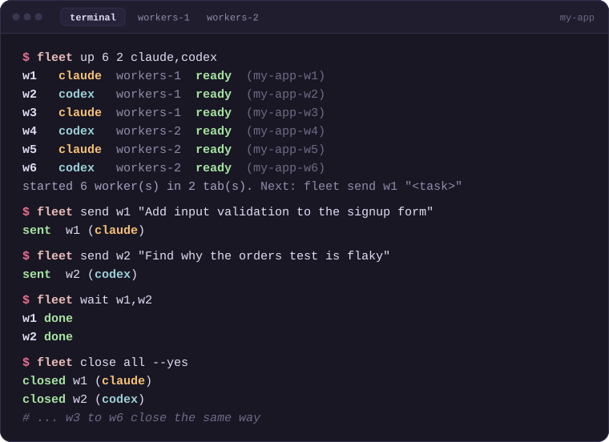
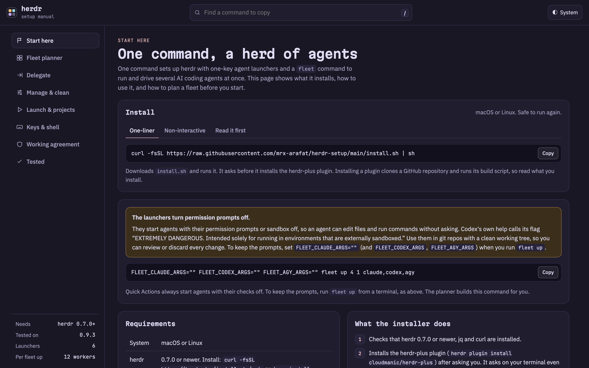
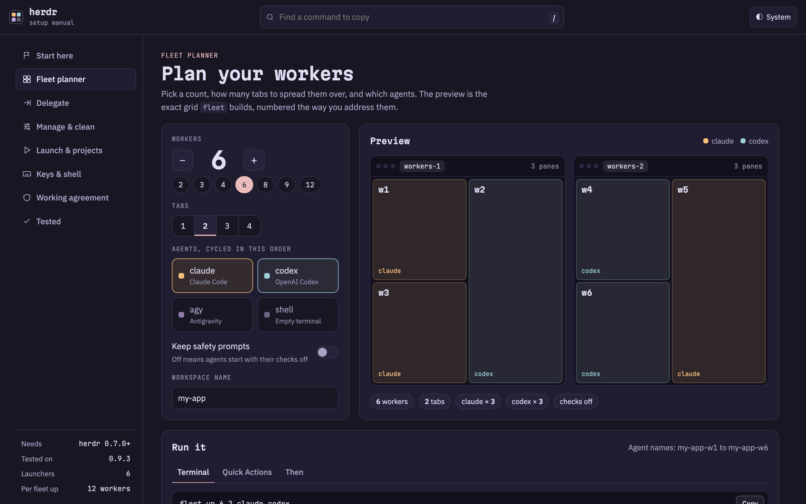
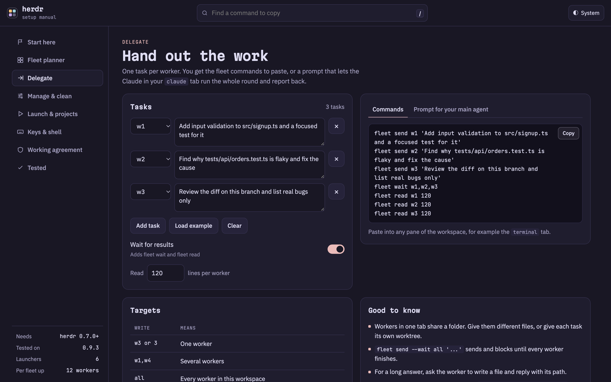

<p align="center">
  <a href="https://mrx-arafat.github.io/herdr-setup/">
    <picture>
      <source media="(prefers-color-scheme: dark)" srcset="docs/assets/banner-dark.svg">
      
    </picture>
  </a>
</p>

<p align="center">
  <a href="https://mrx-arafat.github.io/herdr-setup/"></a>
</p>

<p align="center">
  <a href="https://mrx-arafat.github.io/herdr-setup/"><b>mrx-arafat.github.io/herdr-setup</b></a>
  &nbsp;&middot;&nbsp;
  <a href="#install-in-one-line">Install</a>
  &nbsp;&middot;&nbsp;
  <a href="#your-first-five-minutes">First five minutes</a>
  &nbsp;&middot;&nbsp;
  <a href="docs/GUIDE.md">Full guide</a>
</p>

<p align="center">
  <a href="https://github.com/mrx-arafat/herdr-setup/actions/workflows/check.yml"></a>
  
  
  <a href="LICENSE"></a>
</p>

## Why you will want this

You already use an AI coding agent.
Then you open a second one for a review, a third to chase a flaky test, and soon you are juggling terminal windows, losing track of who is doing what, and copy-pasting prompts around.

This repo turns that mess into a control room.
Claude Code, Codex and Agy run side by side, started in three keystrokes and set up with one command.

<table>
  <tr>
    <td width="50%" valign="top">
      <br>
      <b>Three keystrokes to an agent</b><br>
      Press <code>ctrl+b</code>, then <code>↓</code>, type <code>claude</code> and hit <code>Enter</code>.
      A fresh Claude Code tab opens in the folder you are in.
      The same works for <code>codex</code> and <code>agy</code>.
    </td>
    <td width="50%" valign="top">
      <br>
      <b>Six agents, one command</b><br>
      <code>fleet up 6 2</code> lays out six Claude workers in two tidy tabs of three.
      It returns only when every one of them is ready for work.
    </td>
  </tr>
  <tr>
    <td width="50%" valign="top">
      <br>
      <b>Hand out the work</b><br>
      <code>fleet send w2 "fix the flaky orders test"</code> gives worker 2 its task.
      <code>fleet wait all</code> waits for the whole team, and <code>fleet read w2</code> shows you what it did.
    </td>
    <td width="50%" valign="top">
      <br>
      <b>Safe to run again</b><br>
      One command installs everything, and it asks before it touches anything important.
      It never overwrites a file you already have, so running it again is always safe.
    </td>
  </tr>
</table>

<p align="center">
  
  <br>
  <sub>A whole fleet session: start six workers, hand out two tasks, wait for both, then close everything.</sub>
</p>

## See it before you install

> [!TIP]
> **See it before you install anything.**
> Open the [interactive manual](https://mrx-arafat.github.io/herdr-setup/).
> Drag the worker count, pick your agents, and watch the exact layout appear.
> It hands you the command to copy.
> No install, no sign-up, it all runs in your browser.

<table>
  <tr>
    <td width="33%" align="center" valign="top">
      <a href="https://mrx-arafat.github.io/herdr-setup/#start"></a><br>
      <b>Start here</b><br>
      <sub>The install command, the requirements and the safety note on one page.</sub>
    </td>
    <td width="33%" align="center" valign="top">
      <a href="https://mrx-arafat.github.io/herdr-setup/#planner"></a><br>
      <b>Plan a fleet</b><br>
      <sub>Pick a count, the tabs and the agents, and see the exact grid <code>fleet</code> builds.</sub>
    </td>
    <td width="33%" align="center" valign="top">
      <a href="https://mrx-arafat.github.io/herdr-setup/#delegate"></a><br>
      <b>Hand out work</b><br>
      <sub>Write one task per worker and copy the <code>fleet</code> commands, ready to paste.</sub>
    </td>
  </tr>
</table>

## Install in one line

```sh
curl -fsSL https://raw.githubusercontent.com/mrx-arafat/herdr-setup/main/install.sh | sh
```

That is it.
The installer checks your tools, asks once before adding the plugin, and tells you exactly what it did.

<details>
<summary><b>Prefer to read the script first?</b> (recommended for anything you pipe into a shell)</summary>

```sh
curl -fsSL https://raw.githubusercontent.com/mrx-arafat/herdr-setup/main/install.sh -o install.sh
less install.sh
sh install.sh
```

No questions at all, for scripts and fresh machines:

```sh
curl -fsSL https://raw.githubusercontent.com/mrx-arafat/herdr-setup/main/install.sh | sh -s -- --yes
```

</details>

<details>
<summary><b>What exactly does the installer do?</b></summary>

1. Checks that herdr 0.7.0 or newer, `jq` and `curl` are installed.
2. Installs the [herdr-plus](https://github.com/cloudmanic/herdr-plus) plugin, after asking you.
   It asks on your terminal even when piped from `curl`, and `--yes` skips the question.
3. Downloads `agent-tab.sh`, `fleet.sh` and six Quick Actions from [`files/`](files/) into `~/.config/herdr/plugins/config/cloudmanic.herdr-plus/`.
4. Links `fleet` into `~/.local/bin` when that folder is on your `PATH`, otherwise prints an alias line.
5. Binds `ctrl+b` `↑` to Projects and `ctrl+b` `↓` to Quick Actions in `~/.config/herdr/config.toml`.
6. Reloads herdr and runs `herdr config check`.

It never overwrites a file that exists, never replaces an existing `fleet` command, skips keys you already use, and backs up `config.toml` before it edits it.
To install from another branch or tag, set `HERDR_SETUP_REF`.

</details>

### Before you run it

You need macOS or Linux, [herdr](https://herdr.dev) 0.7.0 or newer, `jq`, `curl`, and at least one agent CLI you are signed in to (`claude`, `codex` or `agy`).
Missing something?

```sh
curl -fsSL https://herdr.dev/install.sh | sh     # herdr (or: brew install herdr)
brew install jq                                   # jq (Debian or Ubuntu: sudo apt install jq)
```

## Your first five minutes

1. **Open herdr in a project.**

   ```sh
   cd ~/your-project
   herdr
   ```

2. **Start an agent.**
   Press `ctrl+b`, let go, press `↓`, type `claude`, press `Enter`.
   A new `claude` tab opens right where you are.

3. **Bring in a team.**
   Press `ctrl+b` then `↓` again, type `workers`, pick **6 workers, two tabs**.
   Six agents appear, labelled `w1` to `w6`.

4. **Give them work.**
   In any other pane of the same workspace:

   ```sh
   fleet send w1 "Add input validation to the signup form and a test for it"
   fleet send w2 "Find out why the orders test is flaky and fix it"
   fleet send w3 "Review the current diff and list real bugs only"
   fleet wait all
   fleet read w2
   ```

5. **Clean up when you are done.**

   ```sh
   fleet close all
   ```

Lost?
Press `ctrl+b` then `?` for every key, or keep the [interactive manual](https://mrx-arafat.github.io/herdr-setup/) open beside you.

## Everything you get

| You do | You get |
| --- | --- |
| `ctrl+b` `↓`, type `claude` | A new tab running Claude Code in your current folder. |
| `ctrl+b` `↓`, type `codex` | A new tab running Codex in your current folder. |
| `ctrl+b` `↓`, type `agy` | A new tab running Agy in your current folder. |
| `ctrl+b` `↓`, type `grid` | One tab, four equal panes: Claude, Codex, Agy and a shell. |
| `ctrl+b` `↓`, type `workers` | Nine ready-made layouts from 2 to 8 agents, or type your own. |
| `ctrl+b` `↑` | Your projects: describe one once, then open its whole workspace in one keypress. |
| `fleet up 6 2 claude,codex` | Six workers in two tabs, Claude and Codex taking turns. |
| `fleet send`, `wait`, `read` | Hand out tasks, wait for the team, read each answer. |
| `fleet clear all` | A fresh chat in every Claude and Codex worker. |
| `fleet close all` | Every worker closed, nothing left behind. |

<details>
<summary><b>The full fleet cheat sheet</b></summary>

| Command | Does |
| --- | --- |
| `fleet up 6 2 claude` | Six Claude workers in two tabs of three. |
| `fleet up 4` | Four Claude workers in a 2x2 grid. |
| `fleet up 6 2 claude,codex,agy` | Six workers that cycle claude, codex, agy. |
| `fleet ls` | Every worker with its agent, status, tab and pane. |
| `fleet send w2 "task"` | Type a task into worker 2. |
| `fleet send --wait all "task"` | Send to every worker and wait until all finish. |
| `fleet wait all` | Wait until busy workers settle. |
| `fleet read w2 120` | The last 120 lines from worker 2. |
| `fleet clear all` | Fresh chat in every Claude and Codex worker. |
| `fleet focus w3` | Jump to worker 3. |
| `fleet close all` | Close every worker (asks first in a terminal). |

Targets are `w3` or `3`, a list like `w1,w4`, `all`, or `idle`.
Up to 12 workers per `fleet up`, and a second `fleet up` keeps counting from where you left off.
The full story is in [Run many workers](docs/GUIDE.md#run-many-workers).

</details>

## Read this once

> [!WARNING]
> To feel instant, the launchers start agents with their permission prompts or sandbox **off**.
> That means an agent can edit files and run commands without asking.
> Use them in git repositories, so you can review and undo every change.
> Want the prompts back for a run?
> Start it with `FLEET_CLAUDE_ARGS="" fleet up 4`.
> The [safety notes](docs/GUIDE.md#safety-notes) explain the details.

## Learn more

- **[Interactive manual](https://mrx-arafat.github.io/herdr-setup/)**: plan a fleet, build a delegation script, browse every key, all in the browser.
- **[The full guide](docs/GUIDE.md)**: from "what is a pane" to worktrees, shell suggestions and keeping one rules file for every agent.

<details>
<summary><b>Update or uninstall</b></summary>

Update herdr with `herdr update`.
To refresh a file from this repo, delete your copy and run the installer again, since it never overwrites existing files.

To remove everything:

```sh
herdr plugin uninstall cloudmanic.herdr-plus
rm ~/.local/bin/fleet
```

Then delete the two `[[keys.command]]` blocks that mention `cloudmanic.herdr-plus` from `~/.config/herdr/config.toml`, and run `herdr server reload-config`.
Skip the `rm` if the installer printed an alias line instead of linking `fleet`.

</details>

<details>
<summary><b>Troubleshooting</b></summary>

| Problem | Fix |
| --- | --- |
| `ctrl+b` then an arrow does nothing | Run `herdr config check`. If `herdr plugin action invoke quick-actions --plugin cloudmanic.herdr-plus` opens the picker, only the key is blocked, so bind another key. |
| I changed `config.toml` and nothing changed | Run `herdr server reload-config`. |
| `fleet: run this inside a herdr pane` | Run `fleet` in a pane inside herdr, not in another terminal. |
| `fleet: command not found` | `~/.local/bin` is not on your `PATH`. Use the alias line the installer printed. |
| A worker says `not ready` after `fleet up` | The agent stopped at a startup question, such as "trust this folder". Click it and answer. |

More fixes are in the guide's [Troubleshooting](docs/GUIDE.md#troubleshooting) section.

</details>

<details>
<summary><b>What is in this repo</b></summary>

- [`install.sh`](install.sh): the one-line installer.
- [`files/scripts/`](files/scripts/): `agent-tab.sh` (one tab, one command) and `fleet.sh` (builds and drives workers).
- [`files/quick-actions/`](files/quick-actions/): the six Quick Actions.
- [`files/worktrees/default.toml`](files/worktrees/default.toml): optional auto-layout for git worktrees.
- [`files/extras/sync-agent-rules`](files/extras/sync-agent-rules): optional, keeps one rules file for every agent.
- [`docs/index.html`](docs/index.html): the interactive manual, served by GitHub Pages.
- [`docs/GUIDE.md`](docs/GUIDE.md): the full written guide.
- [`docs/assets/`](docs/assets/): the banner, icons, terminal illustration and screenshots in this README.
- [`tests/sandbox.sh`](tests/sandbox.sh) and [`.github/workflows/check.yml`](.github/workflows/check.yml): 31 installer checks and shellcheck, run on Linux and macOS for every push.

</details>

## Credits

Built on [herdr](https://herdr.dev) and the [herdr-plus](https://github.com/cloudmanic/herdr-plus) plugin by cloudmanic.
Released under the [MIT license](LICENSE).

<p align="center">
  <a href="https://mrx-arafat.github.io/herdr-setup/"><b>Open the interactive manual</b></a>
  &nbsp;&middot;&nbsp;
  <a href="#install-in-one-line"><b>Install in one line</b></a>
</p>
